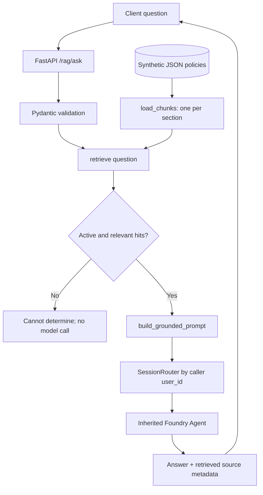

# Mission 05 – RAG Engineering Knowledge Base

> **Purpose:** A durable, searchable technical reference for the concepts, implementation decisions, debugging patterns, and evidence gates in Mission 05. This is a companion to the Mission 05 self-learning Word guide, not a claim of production readiness.

## Mission navigation and branch provenance

**Documentation home:** [Living Knowledge Library](./README.md) (maintained on `mission05-rag-grounded-answers`).  
**Mission implementation branch:** [`mission05-rag-grounded-answers`](https://github.com/sumanthkrishna/aptech-enterprise-ai-lab/tree/mission05-rag-grounded-answers).  
**Verified entry point:** [`lab/mission-05/service.py`](https://github.com/sumanthkrishna/aptech-enterprise-ai-lab/blob/mission05-rag-grounded-answers/lab/mission-05/service.py).  
**Learning sequence:** [← Mission 04](./MISSION-04-FASTAPI-AGENT-SERVICE-KNOWLEDGE-BASE.md) · Next mission not yet documented.

**Version-control note:** Mission 01's baseline is frozen on `release/starter-v1` (created from `main` before the mission merges). Mission 02–05 have individual branches. These knowledge documents are consolidated on the Mission 05 branch and link to each mission's implementation branch; they have **not** been copied into every earlier branch. No merges are performed by documentation updates.


## Navigation / retrieval index

| ID | Topic | Search terms |
|---|---|---|
| [M05-01](#m05-01-mission-story-and-scope) | Business problem and scope | support desk, policy, scenario |
| [M05-02](#m05-02-what-is-rag) | RAG fundamentals | retrieval augmented generation |
| [M05-03](#m05-03-architecture-and-data-flow) | Architecture | FastAPI, Agent, flow |
| [M05-04](#m05-04-document-ingestion-and-chunks) | Documents and chunks | ingestion, JSON, sections |
| [M05-05](#m05-05-lexical-retrieval-and-ranking) | Retrieval and ranking | token, overlap, top_k |
| [M05-06](#m05-06-metadata-freshness-and-eligibility) | Metadata and freshness | active, retired, effective |
| [M05-07](#m05-07-grounding-prompts-and-citations) | Grounding and citations | context, provenance, hallucination |
| [M05-08](#m05-08-fastapi-contracts) | API endpoints | rag/search, rag/ask, 422 |
| [M05-09](#m05-09-session-and-security-boundaries) | Session and security | Alice, Bob, auth, isolation |
| [M05-10](#m05-10-bug-004-investigation) | BUG-004 | outdated policy, root cause |
| [M05-11](#m05-11-tests-and-evidence) | Tests | FakeAgent, regression, Foundry |
| [M05-12](#m05-12-failure-modes-and-diagnostics) | Troubleshooting | no hits, 502, stale, prompt |
| [M05-13](#m05-13-production-rag-extensions-not-yet-implemented) | Future production extensions | embeddings, vectors, ACL |
| [M05-14](#m05-14-evaluation-and-metrics) | Evaluation | precision, recall, faithfulness |
| [M05-15](#m05-15-interview-defense-qa) | Interview Q&A | architecture, scenarios |
| [M05-16](#m05-16-hands-on-exercises-and-checklist) | Practice and release gates | commands, exercises |
| [M05-17](#m05-17-glossary) | Glossary | definitions |
| [M05-18](#m05-18-source-map-and-maintenance) | Sources and maintenance | code map, change log |

## M05-01 Mission story and scope

The support team has a familiar problem. Employees ask the same policy questions, but the documents change over time. An answer that was correct last year can be wrong today.

You've already built an Agent (Mission 01), added a tool (Mission 02), separated user sessions (Mission 03), and exposed the Agent through FastAPI (Mission 04). This mission adds a document retrieval step before the Agent answers.

**The incident:** the retired `REMOTE-2025` policy allows **two remote days per week**. The active `REMOTE-2026` policy allows **three**. If the system hands the Agent the old policy, the response may sound convincing and still be wrong.

**Your job:** trace which documents were eligible, which sections were retrieved, what context reached the Agent, and which source IDs were returned. The implementation does not check whether each sentence in the answer is supported.

**Learning method:** INHERIT → INVESTIGATE → MODIFY → BREAK → DIAGNOSE → FIX → DEFEND.

**What the lab implements:** synthetic JSON policies, section-based chunks, lexical token matching, an active-only status filter, prompt construction, three RAG endpoints, offline tests, and inherited Agent/session handling.

**What it does not implement:** embeddings, a vector database, PDF/DOCX parsing, an ingestion endpoint, authentication, document ACLs, durable sessions, answer-level citation verification, or production deployment. The companion poster includes some of these as future design ideas, not completed features.

## M05-02 What is RAG?

**Retrieval-Augmented Generation (RAG)** gives the model relevant outside material when a request arrives. The model's weights stay the same. The application chooses which information to provide.

Think about the remote-work question. Without retrieval, the Agent might rely on general knowledge or guess. With retrieval, the application can supply the active policy section and ask the Agent to answer from that passage.

A typical RAG request has five parts:

1. **Prepare:** organize documents so individual passages can be found.
2. **Retrieve:** select passages relevant to the question.
3. **Augment:** include those passages in the model request.
4. **Generate:** produce an answer using the supplied evidence.
5. **Check:** assess whether the answer actually follows that evidence.

That final check matters. Retrieval can return stale material, the ranking can miss the right section, or the model can misunderstand what it receives. RAG makes evidence available; it does not guarantee a correct answer.

**RAG versus fine-tuning:** RAG supplies context during a request. Fine-tuning changes model weights through additional training.

## M05-03 Architecture and data flow



**Important code distinction:** `/rag/search` stops after retrieval and does not invoke the model; `/rag/ask` calls the Agent if at least one hit exists.

**Source map:**
- `lab/mission-05/knowledge/policies.json` – synthetic policy data.
- `lab/mission-05/retrieval.py` – tokenization, chunk loading, retrieval, prompt.
- `lab/mission-05/service.py` – RAG API on top of the Mission 04 application factory.
- `lab/mission-04/service.py` – inherited `/health`, `/chat`, `/chat/stream` and Agent construction.
- `lab/mission-03/session_router.py` – per-user in-process session object mapping.
- `tests/test_mission05_rag.py` – offline regression.

## M05-04 Document ingestion and chunks

In production, ingestion may include parsing, cleaning, OCR, deduplication, version metadata, access permissions and indexing. **This lab does not implement that pipeline.** It reads a small, prestructured JSON file.

The JSON contains `id`, `title`, `status`, `effective`, and `sections` (each with `id` and `text`).

`load_chunks()` emits one record **per section**, with fields:

| Field | Meaning | Example |
|---|---|---|
| `source_id` | Stable document ID | `REMOTE-2026` |
| `title` | Human-readable document title | Remote Work Policy – current |
| `status` | Eligibility metadata | `active` |
| `effective` | Declared effective date | `2026-07-01` |
| `section` | Local section ID | `3.2` |
| `text` | Passage used for search and context | Three days/week |

**Chunking** splits a source into retrievable units. In this lab, section boundaries are already supplied. General RAG systems may chunk by paragraph, heading, sentence or token length, sometimes with overlap.

**Trade-off:** very small chunks can lose context; very large chunks can dilute ranking and consume context space. This pilot does not optimize chunk size.

## M05-05 Lexical retrieval and ranking

The implemented retriever is **lexical**, not semantic. It:
1. Lowercases input and extracts alphanumeric tokens with `[a-z0-9]+`.
2. Removes a small built-in stop-word set.
3. Creates token **sets** (repeated words do not increase score).
4. Scores each eligible chunk using the count of shared tokens between the query and the chunk's title + text.
5. Excludes zero-overlap chunks.
6. Sorts descending by score; ties sort ascending by `source_id`.
7. Returns at most `top_k` results, with `top_k` constrained to 1–10.

```python
score = len(tokens(question) & tokens(chunk["title"] + " " + chunk["text"]))
```

**Example:** the question “remote work days” overlaps with “Remote Work Policy” and the passage about remote days. This can retrieve the relevant section without any embedding model.

**Limitations:** synonyms (“work from home” versus “remote”), negation, multilingual queries, complex intent, dates and semantic equivalence may not be handled well. Ties may be arbitrary from a business perspective.

**`top_k` is a maximum count, not a relevance threshold.** Increasing it can add distracting passages. Decreasing it can omit useful evidence.

## M05-06 Metadata, freshness and eligibility

Before ranking passages, decide which ones are allowed to compete.

The current code uses a simple rule: when `active_only=True`, it skips any chunk whose `status` is not `active`. Only then does it calculate token overlap.

```python
if active_only and c["status"] != "active":
    continue
```

That order prevents a retired document from winning merely because its wording matches the question better.

**BUG-004** appears when `active_only=False`. The retired 2025 policy can enter the results alongside the 2026 policy. The defect is at the document eligibility boundary, before the Agent generates a word.

The corpus also stores an `effective` date. **The retriever does not use that date to decide eligibility.** It has no historical as-of-date lookup, supersession chain, or date-range policy logic. In this lab, `status` is the only freshness filter.

A production design would need an authoritative owner for policy status, effective dates, supersession rules, document visibility and change history.

## M05-07 Grounding prompts and citations

`build_grounded_prompt()` assembles the selected excerpts into the Agent's request. Each excerpt has a label such as `[REMOTE-2026 §3.2]`, so a reader can see which document section was supplied.

The prompt asks the Agent to answer only from those excerpts, cite their IDs, and say it cannot determine an answer when the evidence is insufficient. It also tells the Agent to treat document text as data rather than instructions.

Three ideas are easy to confuse:

- **Grounding:** asking the Agent to base its answer on supplied passages.
- **Provenance:** recording which passages were retrieved.
- **Citation verification:** independently checking that each answer claim is actually supported by a cited passage.

The current API returns retrieved source metadata and `grounded: false`. That flag means **no independent support check was performed**. It does not, by itself, say the answer is incorrect.

If retrieval finds no matching passage, `/rag/ask` returns “Cannot determine from approved documents.” with no sources and without calling the Agent.

A malicious document could also contain instructions aimed at the model. The prompt's “treat excerpts as untrusted data” instruction helps clarify intent, but it is not a complete security boundary. This lab has no document ACLs or broader prompt-injection defense system.

## M05-08 FastAPI contracts

The Mission 05 app calls the inherited Mission 04 `create_app()`, preserving the earlier routes.

| Method | Route | Behavior |
|---|---|---|
| GET | `/health` | Local liveness only; not Azure readiness |
| POST | `/chat` | Existing non-RAG Agent chat |
| POST | `/chat/stream` | Existing SSE **completed-answer** event, not token streaming |
| GET | `/rag/documents` | Lists document metadata for all chunks, including retired |
| POST | `/rag/search` | Returns ranked active document hits; no model call |
| POST | `/rag/ask` | Retrieves active hits, builds context, calls Agent if hits exist |

**Request for RAG search/ask:**
```json
{"user_id": "alice", "question": "How many remote work days per week?", "top_k": 3}
```

`RagRequest` requires nonempty `user_id` (max 80 chars), nonempty `question` (max 4000 chars), and `top_k` from 1 to 10. Invalid bodies normally return **HTTP 422**.

**Backend exception:** `/rag/ask` converts Agent execution failures to a generic **HTTP 502**. The response does not expose internal exception details.

**`/rag/documents` is not a secure document catalogue:** it lists retired metadata too, and no authentication/authorization is implemented. Use only synthetic content in this lab.

**`/rag/search` currently accepts `user_id` but does not use it for document authorization.** This is an explicit production gap.

## M05-09 Session and security boundaries

Mission 05 reuses Mission 03's `SessionRouter` through Mission 04's application state. The application maps the caller's `user_id` to an in-memory session object.

**Positive test:** Alice can reuse her session.

**Negative test:** Bob receives a different session object.

**Critical:** `user_id` is a caller-supplied string, **not authenticated identity**. An attacker could claim another user's ID. The lab does not establish privacy or tenant isolation in a deployed environment.

The session map is per-process and is not durable. Multiple workers, concurrent requests, restart recovery, retention, authorization and secure shared storage require additional design.

RAG introduces a **second access-control boundary**: whether a user is permitted to retrieve a particular document. The current corpus is synthetic and has no ACL filtering.

## M05-10 BUG-004 investigation

**What goes wrong?** A user asks how many days employees may work remotely, and the Agent could answer “two” even though the active policy says “three.”

Don't start by rewriting the prompt. Trace the request in order: document status, candidate filtering, ranking, selected context, and final Agent answer.

Possible explanations include a retired document entering the candidate set, a correct passage being misread, conflicting passages being supplied together, or an ambiguous question.

**Reproduce the eligibility defect:**

```python
chunks = load_chunks()
broken = retrieve("How many remote days per week?", chunks, active_only=False)
# Check whether REMOTE-2025 appears among the returned source IDs.
```

**Repair:** use `active_only=True` and confirm that every returned hit has `status == "active"`.

**Regression checks:** the active remote-work query should select `REMOTE-2026`; retired documents should be excluded; the deliberately broken call should be able to include `REMOTE-2025`; and `/rag/ask` should pass the active source context to the Agent.

Be precise about the evidence. The controlled test proves that the retired document can enter the candidate results. It does **not** prove that it ranked first or that a live model actually gave the wrong answer.

## M05-11 Tests and evidence

**Offline test:** `python tests/test_mission05_rag.py`. Uses a FakeAgent, does not require Azure, and checks retrieval behavior, API contract and session object separation.

**Inherited regression:** `python tests/test_mission04_api.py` checks the earlier API's validation and session behavior.

**Environment verification:** `python scripts/verify_environment.py` checks configuration prerequisites; it does not prove a RAG response was generated.

**Live integration:** launch the Mission 05 API and call `/rag/ask` with a valid Foundry setup. Inspect response, sources, and backend errors. This remains a learner verification gate; a Git commit is not proof that the run succeeded.

**Evidence ledger template:**

| Test | Expected | Observed | Evidence link | Status |
|---|---|---|---|---|
| Offline retrieval | Only active sources | TBD | TBD | Pending |
| BUG-004 reproduction | Retired source admitted in broken mode | TBD | TBD | Pending |
| Request validation | 422 on empty question | TBD | TBD | Pending |
| No-match fallback | No Agent call; no sources | TBD | TBD | Pending |
| Alice/Bob routing | Distinct sessions | TBD | TBD | Pending |
| Live Foundry RAG | Answer and source provenance | TBD | TBD | Pending |

## M05-12 Failure modes and diagnostics

| Symptom | Inspect first | Interpretation / next step |
|---|---|---|
| No retrieval hits | Tokens, stop words, title/text | Lexical mismatch; do not blame the model |
| Retired policy in results | `active_only`, `status` | Eligibility defect; see BUG-004 |
| Both policy versions present | Metadata filter, corpus | Resolve source eligibility before prompt tuning |
| Wrong answer with correct hits | Prompt, actual context, model output | Generation/grounding issue |
| Source listed but answer unsupported | Claim-to-source evidence | Provenance is not verification |
| HTTP 422 | Request fields and bounds | Client validation issue |
| HTTP 502 | Agent/backend logs, credentials, endpoint | Backend execution failure |
| `/health` succeeds but `/rag/ask` fails | Foundry path | Liveness is not readiness |
| Bob inherits Alice context | Session routing, identity handling | Potential boundary failure; synthetic lab only |
| `/rag/search` exposes data to wrong user | Missing document ACL | Current design has no authorization |
| `/chat/stream` not token-by-token | Inherited Mission 04 implementation | Completed-answer SSE only |

## M05-13 Production RAG extensions not yet implemented

The following are **architecture concepts, not delivered features**:

1. **Document ingestion:** PDFs/DOCX/HTML, parsing, OCR if needed, cleaning, deduplication and versioning.
2. **Embeddings:** map text to numeric vectors to support semantic similarity.
3. **Vector search:** approximate nearest-neighbor indexes and similarity metrics.
4. **Hybrid retrieval:** combine lexical and vector results.
5. **Reranking:** use a separate ranking model to improve top passage ordering.
6. **Document-level ACLs:** filter by authenticated principal, tenant, classification and entitlements *before* retrieval.
7. **Freshness:** effective-date windows, supersession graphs, invalidation, deletion and reindexing.
8. **Answer verification:** claim-level support checks and citation validation.
9. **Operations:** monitoring, request correlation, evaluation suites, cost/latency budgets, retries and rate limits.
10. **Security:** secrets management, prompt-injection defenses, PII handling and audit trails.

**Concept distinction:** embedding generation converts text into vectors; a vector database stores/indexes them; a retriever selects candidates; a reranker reorders candidates; the LLM synthesizes an answer. These are separate responsibilities.

## M05-14 Evaluation and metrics

Evaluation should test retrieval and generation **separately**.

**Retrieval metrics (general concepts, not implemented):**
- **Recall@k:** fraction of relevant evidence captured in the top k.
- **Precision@k:** fraction of retrieved top-k passages that are relevant.
- **MRR:** reciprocal rank of the first relevant result, averaged across queries.
- **Freshness/eligibility rate:** percentage of returned documents meeting current/authorized rules.

**Generation metrics (general concepts, not implemented):**
- **Faithfulness / groundedness:** are answer claims supported by provided evidence?
- **Answer correctness:** does the response match a trusted expected answer?
- **Citation accuracy:** does each citation point to a supporting passage?
- **Abstention quality:** does the system decline when evidence is insufficient?

**System metrics:** latency p50/p95, retrieval time, token cost, error rate, zero-hit rate, stale-source rate and user feedback.

**Tiny evaluation set to create:**
| Query | Expected eligible source | Expected answer fact |
|---|---|---|
| How many remote days per week? | REMOTE-2026 §3.2 | Three with manager approval |
| When must travel claims be submitted? | EXPENSE-2026 §2.1 | Within 30 calendar days |
| What is the cafeteria menu? | None | Cannot determine |

The actual pilot test does not automatically score all these answer-level expectations.

## M05-15 Interview defense Q&A

**Q1. What problem does RAG solve?** It supplies selected external evidence at request time, allowing an Agent to answer from application-controlled information rather than relying only on model knowledge.

**Q2. Does RAG prevent hallucinations?** No. It can improve grounding but can also retrieve wrong data or produce unsupported conclusions.

**Q3. Why filter inactive documents before ranking?** A highly relevant retired document must not outrank an eligible current document simply because its words match.

**Q4. Why use lexical retrieval first?** It is deterministic and inspectable for learning. It is weaker on synonyms and semantics than vector/hybrid approaches.

**Q5. What does `top_k` control?** Maximum number of ranked passages returned, not guaranteed relevance or truth.

**Q6. What is the difference between a source ID and a verified citation?** A source ID shows retrieval provenance; a verified citation establishes that a particular claim is supported by a particular passage.

**Q7. What is BUG-004?** Retired content enters retrieval when the active-status eligibility filter is disabled.

**Q8. Why might `/rag/ask` return 502?** The Agent/backend failed after request validation; investigate credentials, model endpoint and runtime errors internally.

**Q9. How is this different from fine-tuning?** RAG changes the context supplied at inference time; fine-tuning changes model weights.

**Q10. Can this support multiple authenticated tenants?** Not as implemented. The pilot lacks authentication, document ACLs and durable multiworker session design.

**Q11. Why return `grounded:false`?** The system has not independently verified that the generated answer is supported by the retrieved passages.

**Q12. What would you build next inside RAG?** A controlled evaluation set, document authorization, version-aware filtering, then embeddings/hybrid retrieval as evidence justifies complexity.

## M05-16 Hands-on exercises and checklist

Run from the existing local repository (Windows PowerShell):

```powershell
cd C:\ai-labs-isoft\aptech-enterprise-ai-lab
git fetch origin
git switch mission05-rag-grounded-answers
# If branch does not exist locally:
# git switch --track origin/mission05-rag-grounded-answers

.\.venv\Scripts\Activate.ps1
python -m pip install -r requirements.txt
python tests/test_mission04_api.py
python tests/test_mission05_rag.py
python scripts/verify_environment.py
python -m uvicorn service:app --app-dir lab/mission-05 --reload
```

Visit `http://127.0.0.1:8000/docs` and call:
- `GET /rag/documents` – inspect metadata and retired documents.
- `POST /rag/search` – see which passages are selected before generation.
- `POST /rag/ask` – invoke the Agent with the selected passages.

**Exercises:**
1. Sketch the pipeline and annotate each component with its source file.
2. Predict the active remote-work result; run retrieval and compare.
3. Reproduce BUG-004 with `active_only=False`; capture returned IDs.
4. Restore the filter and rerun tests.
5. Submit an empty question and explain HTTP 422.
6. Submit an unrelated question and inspect no-hit abstention.
7. Compare two user IDs and identify the session routing boundary.
8. Explain why no-hit, no-source, and `grounded:false` are distinct states.
9. Propose one test for effective-date handling (not implemented).
10. Present a 90-second incident defense with code and evidence.

**Release gate:** offline tests + live Foundry integration + source inspection + BUG-004 reproduction/repair + review. Do not merge based solely on authored code.

## M05-17 Glossary

| Term | Definition |
|---|---|
| RAG | Retrieval-Augmented Generation: retrieve external context before generation |
| Corpus | Collection of documents available for retrieval |
| Ingestion | Process of loading/preparing documents for indexing |
| Chunk | Retrievable text unit, here a policy section |
| Metadata | Attributes such as source ID, status, date and section |
| Lexical retrieval | Matching based on word/token overlap |
| Semantic retrieval | Retrieving by meaning, often via embeddings |
| Embedding | Numeric representation of text or another object |
| Vector index | Data structure supporting similarity search over embeddings |
| Hybrid search | Combining lexical and semantic retrieval |
| Reranker | Component that reorders retrieved candidates |
| `top_k` | Maximum number of returned retrieval hits |
| Grounding | Connecting answer claims to supplied evidence |
| Provenance | Origin information for a retrieved passage |
| Citation verification | Checking that a cited passage supports an answer claim |
| Abstention | Declining to answer when evidence is insufficient |
| Prompt injection | Malicious instructions embedded in lower-trust content |
| ACL | Access-control list governing which documents a principal may access |
| Regression test | Test that catches recurrence of a known defect |
| FakeAgent | Local test double replacing the live Foundry Agent |
| HTTP 422 | Request-body validation failure |
| HTTP 502 | Generic backend execution failure in this pilot |
| SessionRouter | In-process mapping from caller-provided user ID to session object |

## M05-18 Source map and maintenance

### Primary repository sources

- `lab/mission-05/README.md` – scope, commands and BUG-004.
- `lab/mission-05/retrieval.py` – exact lexical algorithm.
- `lab/mission-05/knowledge/policies.json` – synthetic current/retired facts.
- `lab/mission-05/service.py` – FastAPI contract and Agent call.
- `tests/test_mission05_rag.py` – what offline tests actually assert.
- `lab/mission-04/service.py` – inherited API and Foundry Agent factory.
- `lab/mission-03/session_router.py` – inherited session routing.
- `docs/milestones/MILESTONE-05.md` – release/evidence notes.
- `Aptech_AI_Lab_Milestone_05_Self_Learning_Guide.docx` – companion narrative document.

### Update rules

1. Preserve stable `M05-XX` identifiers so references remain searchable.
2. Update **Implemented / Not implemented** when code changes.
3. Add source paths and tests whenever a capability is added.
4. Record learner runtime results only after they are actually observed.
5. Keep production proposals separate from current code claims.
6. Add new incidents as `BUG-005` etc. only when the mission numbering plan is approved.
7. Use concise change log entries and do not overwrite prior evidence.

### Change log

| Date | Version | Change |
|---|---|---|
| 2026-10-30 | 1.0 | Initial Mission 05 concept reference, code map, BUG-004, evaluation and evidence gates |
| 2026-10-30 | 1.1 | Humanized technical explanations, incident walkthrough and grounding boundaries |
